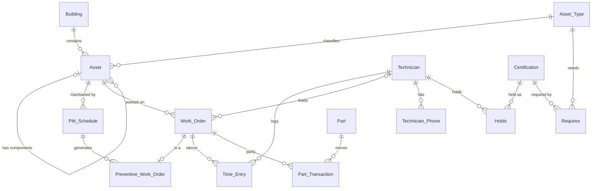

# Preventive Maintenance Database

A MySQL 8 database for a facilities contractor that maintains equipment in client buildings: assets, preventive maintenance plans, work orders, technician certifications, labour and parts. It comes with a seeded generator that produces three years of realistic, rule-abiding data (about 26,000 rows), a set of analytics queries, and tests that prove the business rules hold.

  [](https://github.com/aryankuckreja/preventive-maintenance-db/actions/workflows/database.yml)

> Built in SE 3309 (Database Management Systems) at Western University, Fall 2026, as a team of four (Group 20). The schema, constraints and triggers were designed together. My part of the assignment was the data generator and the staged load process. The analytics queries, the test suite, the Docker setup and CI were added to this repository afterwards.

## At a glance

| | |
|---|---|
| Relations | 14 (including a superclass/subclass pair, two weak entities and two many-to-many relations) |
| Business rules | 33 CHECK constraints and 5 triggers for rules keys cannot express |
| Generated data | 360 assets in 25 buildings, 60 technicians, 5,329 work orders, 11,190 time entries, 5,268 part transactions |
| Reproducibility | `random.seed(3309)`: the generator writes the same files byte for byte on every run (checked in CI) |
| Tests | 7 integrity checks over the loaded data, 9 rule-breaking statements that must be rejected with the right error |

## Data model



The rules that keys cannot express are enforced in the database, not in application code:

| Rule | Enforced by |
|---|---|
| A component sits in the same building as its parent asset | trigger on `Asset` (insert and update) |
| Only a preventive work order can link to a PM schedule, and both must be on the same asset | trigger on `Preventive_Work_Order` |
| A technician can only log time on an asset if they hold every certification its type requires, unexpired on the work date | trigger on `Time_Entry` |
| Issuing parts reduces stock, returns add it back, and an issue larger than the stock on hand is rejected | trigger on `Part_Transaction`, plus a CHECK on `Part` |
| `failure_cause` exists only on reactive work orders and is required once one is closed | CHECK constraints |
| `closed_date` is set exactly when a work order is closed or cancelled; lead technician and assigned date are both set or both empty | CHECK constraints |

Historical rates and prices (`rate_charged`, `unit_cost_at_time`) are stored on each transaction because they cannot be derived later once rates change.

## Generating realistic data that passes the triggers

The generator ([`generator/gen_data.py`](generator/gen_data.py), standard library only) is the part I wrote. The hard constraint is that the database rejects anything that breaks a rule, which means the data has to be valid by construction:

- **Keys are sequential** (`A-00001`, `PM-00001`, work orders from `100001`) and never collide.
- **Foreign keys always point backwards**: buildings, then assets, then schedules, then work orders, then labour and parts. Every join returns rows.
- **The generator applies the same rules as the triggers.** A `qualified(type, date)` function picks only technicians whose trade fits the asset and whose required certifications are valid on that date. Components inherit their parent's building. Preventive work orders are created from their schedule's asset.
- **Stock never goes negative.** After all part movements are generated, each part's starting stock is set to cover its peak running usage, then about a quarter of parts are deliberately left at or below their reorder level so the stock-room report has something to find.
- **The data behaves like a real portfolio.** Breakdown rates differ by equipment type (elevators fail far more often than transformers), PM intervals follow the category (elevators monthly, electrical semi-annually), most certifications are renewed but some lapse, about 4% of assets are retired, and labour rates and part prices drift upward over the three years.
- **Two-stage load.** Certification requirements (`Requires`) are inserted by hand-written SQL between the reference data and the operational data, because the time-entry trigger needs them before any labour can be loaded. See [`docs/data-generation.md`](docs/data-generation.md).

## What the data says

[`queries/analytics.sql`](queries/analytics.sql) answers eight questions a maintenance manager would ask, using CTEs and window functions (`LAG`, `DENSE_RANK`, rolling `SUM ... ROWS BETWEEN 11 PRECEDING`). Some results from the seeded data:

| Question | Finding |
|---|---|
| Which equipment fails most often? (Q3, `LAG` over each asset's breakdowns) | Passenger elevators break down every 50 days on average, freight elevators every 68 |
| Are PMs done on time? (Q2) | Plumbing PM compliance fell to 35% in 2026 Q1, against 60 to 80% for other categories |
| Repair or replace? (Q4) | Three sump pumps cost more to repair in the last 12 months than to replace |
| Where is coverage thin? (Q7) | 13 active backflow preventers, but only 2 technicians are certified to work on them |
| What needs reordering? (Q6) | Four parts are at zero stock with recent demand |

The other queries cover the overdue backlog by building and priority (Q1), technician workload ranked within each trade (Q5) and monthly spend per building with a rolling 12-month total (Q8). [`queries/modifications.sql`](queries/modifications.sql) shows set-based changes: opening follow-up work orders for repeat failures with `INSERT ... SELECT` and `ROW_NUMBER()`, raising reorder levels for fast-moving parts, and purging old cancelled orders that never had labour or parts booked.

## Run it

With Docker:

```bash
docker compose up -d
export MYSQL="mysql -h 127.0.0.1 -P 3307 -u root -ppm"
scripts/load.sh     # generate data, create schema, load in order
scripts/test.sh     # integrity checks, trigger tests, analytics
$MYSQL --table < queries/analytics.sql
```

With a local MySQL 8 server, leave `MYSQL` unset (defaults to `mysql -u root`). CI runs the same steps against a MySQL 8 service container on every push.

## Repository layout

```
schema/01_schema.sql        tables, CHECK constraints, indexes, triggers
schema/02_requires.sql      certification requirements (three INSERT styles)
generator/gen_data.py       seeded data generator -> build/load_stage1.sql, build/load_stage2.sql
queries/analytics.sql       eight analytics queries
queries/modifications.sql   three set-based data modifications
tests/integrity.sql         rule checks over the loaded data (all must return 0)
tests/trigger_tests.sql     rule-breaking statements and the error each must raise
tests/run_trigger_tests.py  runs each case in a rolled-back transaction
scripts/load.sh, test.sh    build and verify
```

## Credits

SE 3309 Group 20, Western University: schema, constraints and triggers designed as a team of four. Data generation and load pipeline: Aryan Kuckreja. All names, buildings, model numbers and postal codes in the data are made up.
