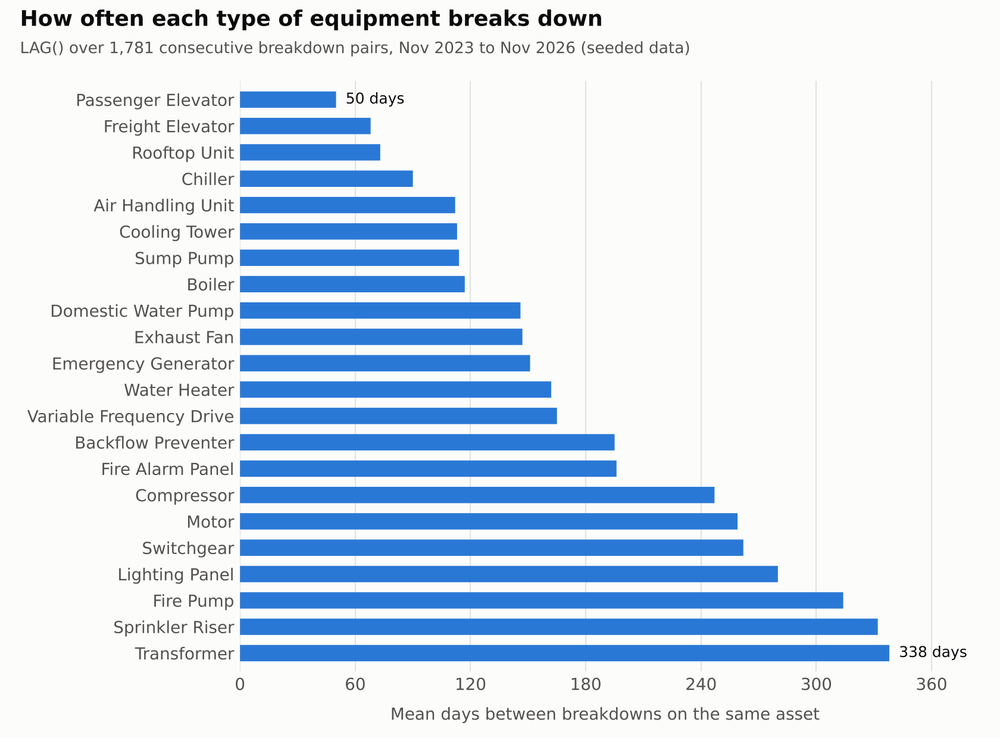
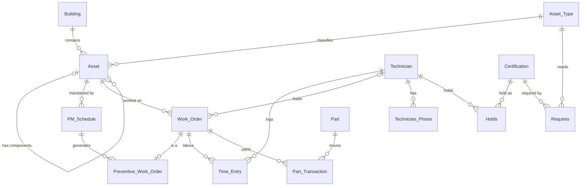

# Preventive Maintenance Database

A MySQL 8 database for a facilities contractor that maintains equipment in client buildings. It tracks assets, preventive maintenance plans, work orders, technician certifications, labour and parts, and it enforces the business rules inside the database itself. A seeded generator fills it with three years of realistic data (about 26,000 rows) that has to pass every one of those rules to load.

[](https://github.com/aryankuckreja/preventive-maintenance-db/actions/workflows/database.yml)


<picture>
  <source media="(prefers-color-scheme: dark)" srcset="docs/img/breakdown-intervals-dark.png">
  
</picture>

<sub>Output of query Q3 on the seeded data, computed with <code>LAG()</code> over each asset's breakdown history.</sub>

## Contents

[Highlights](#highlights) · [Data model](#data-model) · [Design decisions](#design-decisions) · [Generating the data](#generating-data-that-passes-the-triggers) · [Analytics](#analytics) · [Tests](#tests) · [Run it](#run-it) · [Lessons](#lessons-from-building-it) · [Credits](#credits)

## Highlights

- **Schema:** 14 relations, including a work-order superclass with a preventive subclass, two weak entities (time entries, part transactions), two many-to-many relations (certifications held and required) and a self-referencing asset hierarchy.
- **Rules in the database:** 33 CHECK constraints and 5 triggers. A technician without a valid licence cannot log time on a chiller, and a parts issue larger than the stock on hand is refused.
- **Data:** 360 assets in 25 buildings, 60 technicians, 5,329 work orders, 11,190 time entries and 5,268 part transactions, November 2023 to November 2026.
- **Reproducible:** the generator is seeded with `random.seed(3309)` and writes identical files on every run. CI checks this with SHA-256.
- **Verified:** every push loads the full dataset into MySQL 8, runs 7 integrity checks, and confirms that 9 rule-breaking statements are each rejected with the expected error.

## Data model



Rules that keys alone cannot express, and where each one lives:

| Business rule | Enforced by |
|---|---|
| A component sits in the same building as its parent asset | trigger on `Asset` (insert and update) |
| Only a preventive work order can link to a PM schedule, and both must be on the same asset | trigger on `Preventive_Work_Order` |
| A technician logs time on an asset only if they hold every certification its type requires, valid on the work date | trigger on `Time_Entry` |
| Issuing parts reduces stock and returns add it back; an issue larger than the stock on hand is refused | trigger on `Part_Transaction`, backed by a CHECK on `Part` |
| `failure_cause` exists only on reactive work orders and is required once one is closed | CHECK constraints on `Work_Order` |
| `closed_date` is set exactly when a work order is closed or cancelled; a lead technician and an assigned date are both set or both empty | CHECK constraints on `Work_Order` |

The full schema is in [`schema/01_schema.sql`](schema/01_schema.sql).

## Design decisions

- **Reactive work orders are merged into `Work_Order`; preventive ones keep a subclass table.** A reactive order adds a single attribute (`failure_cause`), which made a separate table a join with no benefit. A nullable column plus two CHECK constraints keeps the rule exact. Preventive orders carry a real relationship (the PM schedule that generated them), which is why they keep `Preventive_Work_Order`.
- **Rules live in the database, not in application code.** Anything that writes to these tables (an app, a script, a bulk import) is held to the same rules. CHECK constraints cover rules about one row; triggers cover rules that need another table, such as certification validity on the work date.
- **Historical prices are stored, not derived.** `Time_Entry.rate_charged` and `Part_Transaction.unit_cost_at_time` record what was actually charged. Technicians get raises and part prices change, which means joining to today's rate would restate past costs.
- **Weak entities use composite keys and cascade.** Time entries and part transactions are numbered within their work order (`wo_number, entry_no`) and are removed with it.
- **Indexes follow the main searches.** Backlog by status and due date, breakdowns by type and date, hours by work date, and asset and technician lookups by name. MySQL already indexes every primary and foreign key.

## Generating data that passes the triggers

The generator ([`generator/gen_data.py`](generator/gen_data.py), Python standard library only) was my part of the project. The database rejects anything that breaks a rule, which means the data has to be valid by construction:

- **Keys are sequential** (`A-00001`, `PM-00001`, work orders from `100001`) and never collide.
- **Foreign keys always point backwards.** Buildings come first, then assets, schedules, work orders, and finally labour and parts. Every join returns rows.
- **The generator applies the same rules as the triggers.** A `qualified(type, date)` function picks only technicians whose trade fits the equipment and whose required certifications are valid on that date. Components inherit their parent's building, and preventive work orders are created from their schedule's asset.
- **Stock never goes negative.** After every part movement exists, each part's starting stock is set to cover its peak running usage. About a quarter of parts are then left at or below their reorder level, which gives the stock-room report something real to find.
- **The data behaves like a real portfolio.** Breakdown rates differ by equipment type, PM intervals follow the category (elevators monthly, electrical twice a year), most certifications are renewed but some lapse, about 4% of assets are retired, and labour rates and part prices rise over the three years.
- **The load runs in two stages.** Certification requirements are inserted between the reference data and the operational data, because the time-entry trigger checks every labour row against them.

Details, row counts and the load order are in [`docs/data-generation.md`](docs/data-generation.md).

## Analytics

[`queries/analytics.sql`](queries/analytics.sql) answers eight questions a maintenance manager would ask, using CTEs and window functions. The chart at the top comes from this one:

```sql
-- Q3. Mean days between breakdowns for each asset type
WITH failures AS (
    SELECT a.type_name,
           w.asset_tag,
           w.opened_date,
           LAG(w.opened_date) OVER (PARTITION BY w.asset_tag
                                    ORDER BY w.opened_date, w.wo_number) AS prev_failure
    FROM Work_Order w
    JOIN Asset a ON a.asset_tag = w.asset_tag
    WHERE w.wo_type = 'Reactive'
)
SELECT type_name,
       COUNT(prev_failure)                                AS intervals,
       ROUND(AVG(DATEDIFF(opened_date, prev_failure)), 0) AS mean_days_between_failures
FROM failures
WHERE prev_failure IS NOT NULL
GROUP BY type_name
ORDER BY mean_days_between_failures;
```

What the eight queries find in the seeded data:

| Query | Question | Finding |
|---|---|---|
| Q1 | Which open work orders are past due? | Overdue orders grouped by building and priority, including how many have no technician assigned |
| Q2 | Are preventive tasks done on time? | Plumbing on-time completion fell to 35% in 2026 Q1 (17 tasks), against 60% to 82% for the other categories |
| Q3 | Which equipment fails most often? | Passenger elevators break down every 50 days on average; transformers every 338 |
| Q4 | Repair or replace? | Three sump pumps cost more to repair in the last 12 months than to replace |
| Q5 | Who is carrying the workload? | Hours per technician over 6 months, ranked within each trade with `DENSE_RANK()` and compared to the trade average |
| Q6 | What needs reordering? | Four parts are at zero stock with demand in the last 90 days |
| Q7 | Where is certification coverage thin? | 13 active backflow preventers, but only 2 technicians are certified to work on them |
| Q8 | How is spend trending? | Monthly maintenance cost per building with a rolling 12-month total (`ROWS BETWEEN 11 PRECEDING AND CURRENT ROW`) |

Sample output (Q7, first rows):

```
+--------------------+----------------+---------------+------------------+---------------+
| type_name          | certs_required | qualified_now | qualified_in_90d | active_assets |
+--------------------+----------------+---------------+------------------+---------------+
| Backflow Preventer |              1 |             2 |                2 |            13 |
| Fire Alarm Panel   |              1 |             3 |                3 |            18 |
| Rooftop Unit       |              2 |             4 |                3 |            16 |
| Passenger Elevator |              1 |             5 |                5 |             8 |
| Freight Elevator   |              1 |             5 |                5 |            14 |
+--------------------+----------------+---------------+------------------+---------------+
```

[`queries/modifications.sql`](queries/modifications.sql) shows set-based changes: opening follow-up work orders for repeat failures with `INSERT ... SELECT` and `ROW_NUMBER()`, raising reorder levels for fast-moving parts, and removing old cancelled orders that never had labour or parts booked.

## Tests

[`scripts/test.sh`](scripts/test.sh) runs after every load. The integrity checks query the loaded data for rule violations and must all return 0. The trigger tests try to break each rule inside a transaction that is rolled back, and pass only if MySQL rejects the statement with the expected error, which means a statement refused for the wrong reason still fails the test. Output from the CI run on MySQL 8.0:

```
== Integrity checks
  component in a different building than its parent                        0
  preventive work order on a different asset than its schedule             0
  time logged by a technician missing a required, unexpired certification  0
  part with negative stock                                                 0
  closed reactive work order without a failure cause                       0
  work order with time logged before it was opened                         0
  Requires rows differ from the 16 the generator assumes                   0
== Rule-breaking statements (each must be rejected)
  ok  component placed in a different building than its parent
      ERROR 1644 (45000): A component must be in the same building as its parent asset
  ok  technician without the 313A licence logs time on a chiller
      ERROR 1644 (45000): Technician is not certified for this asset type on the work date
  ok  issuing more parts than are on hand
      ERROR 1644 (45000): Not enough stock on hand for this issue
  ok  preventive work order closed without a closed date
      ERROR 3819 (HY000): Check constraint 'ck_wo_closed_date' is violated.
  ...
  9 of 9 cases rejected with the expected error
== Analytics queries run without errors
  8 queries ok
All checks passed.
```

## Run it

With a local MySQL 8 server, Python 3 and the `mysql` command-line client:

```bash
export MYSQL="mysql -u root"   # add -h, -P and credentials as needed
scripts/load.sh      # generate the data, create the schema, load in order
scripts/test.sh      # integrity checks, trigger tests, analytics
$MYSQL --table < queries/analytics.sql
```

The whole load takes a few seconds. CI runs the same steps against MySQL 8.0 on every push.

<details>
<summary><b>Repository layout</b></summary>

```
schema/01_schema.sql        tables, CHECK constraints, indexes, triggers
schema/02_requires.sql      certification requirements (three INSERT styles)
generator/gen_data.py       seeded generator -> build/load_stage1.sql, build/load_stage2.sql
queries/analytics.sql       eight analytics queries
queries/modifications.sql   three set-based data modifications
tests/integrity.sql         rule checks over the loaded data (all must return 0)
tests/trigger_tests.sql     rule-breaking statements and the error each must raise
tests/run_trigger_tests.py  runs each case in a rolled-back transaction
scripts/load.sh, test.sh    build and verify
docs/data-generation.md     how each table is generated
```

</details>

## Lessons from building it

- **Generating data against live triggers is a test suite in itself.** Any mistake in the generator (a component placed in the wrong building, or labour logged by a technician whose licence had lapsed) stops the load with the trigger's error message. The triggers check the generator as much as the generator exercises the triggers.
- **Load order is a dependency graph.** The certification requirements had to sit between two halves of the generated data, which is the reason for the two-stage load.

## Credits

Built in SE 3309 (Database Management Systems) at Western University, Fall 2026, by Group 20, a team of four. The schema, constraints and triggers were designed as a team. The data generator and the staged load are my part of the assignment. After the assignment I added the analytics queries, the tests and CI. I use Claude as a working part of my development process, and those additions were built with Claude under my direction; I reviewed every query against the data and every test against the schema.

All names, buildings, model numbers and postal codes in the data are made up.
